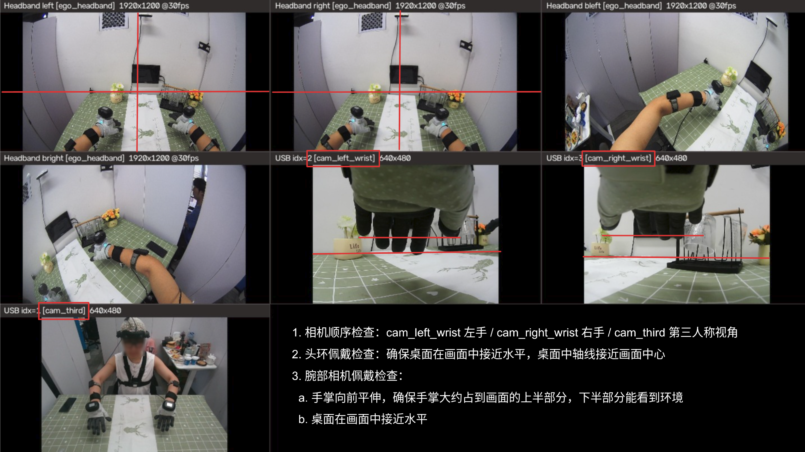
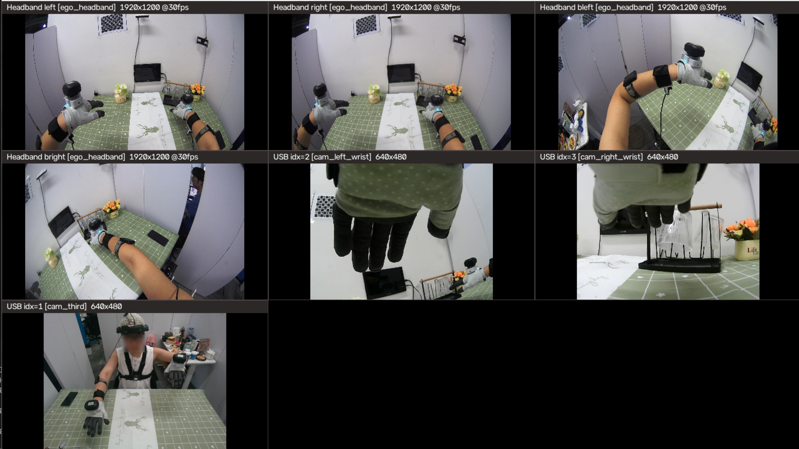
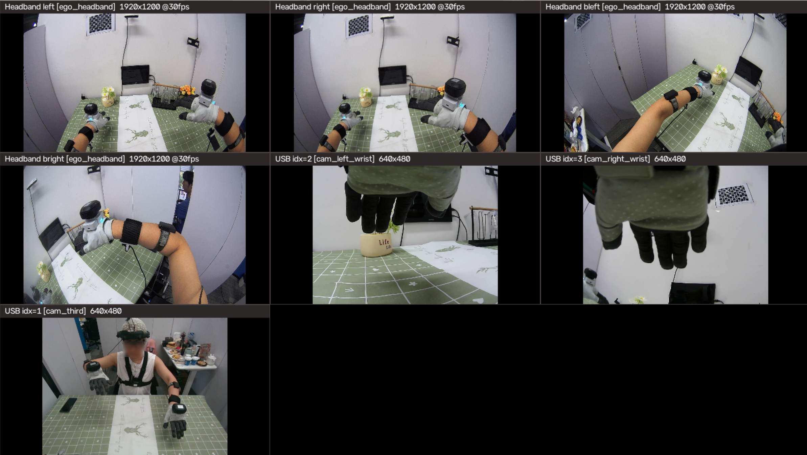
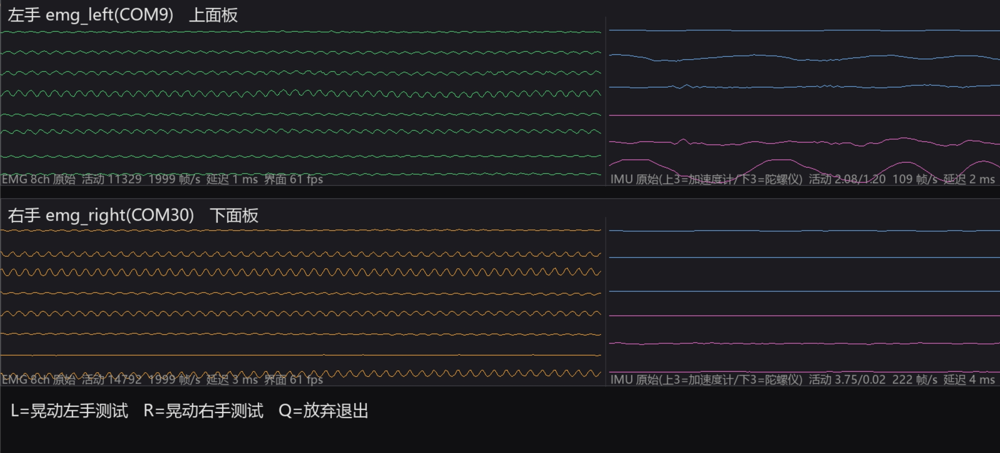
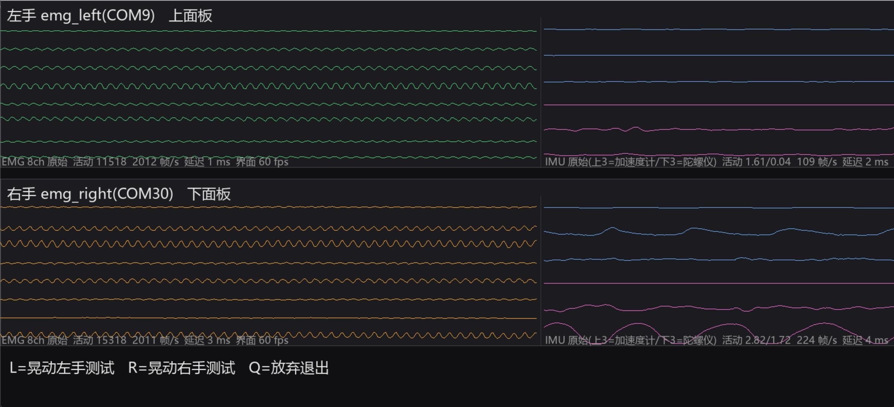
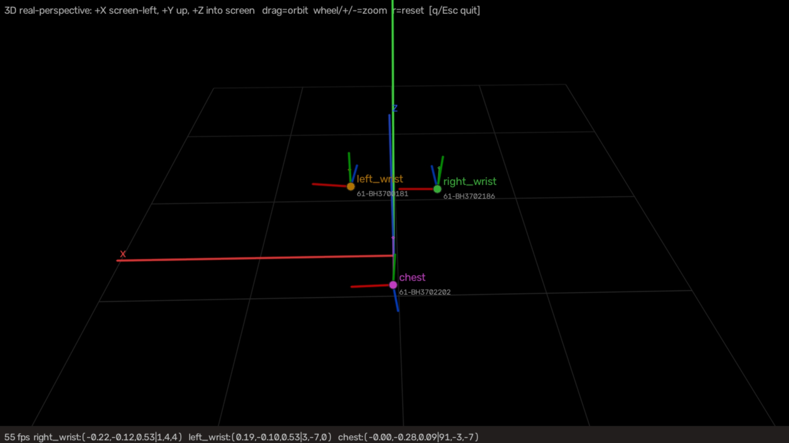
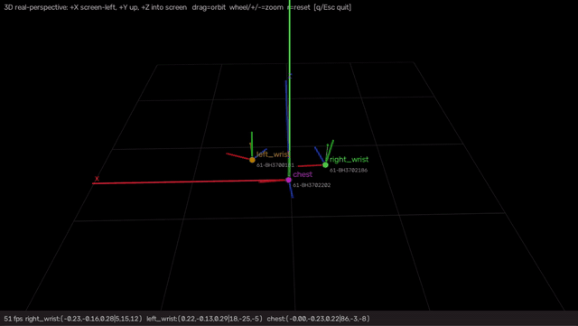

# 采集员检查规范（图示版）

> **三条铁律**
> 1. 检查不过，绝不开录；
> 2. 任何设备重插、重穿、换人，四查（相机/EMG/Vive/穿戴）全部重做；
> 3. 📸 项合格后拍照发采集群，**没照片 = 没做**（屏幕照结论文字必须清晰）。

---

## 一、相机检查 📸

```
python scripts/check_cameras.py
```

**做什么**：对照下图，逐格核对"标签 ↔ 画面"。



**合格结果（与图一致）**：

| 窗口标签 | 画面必须看到 |
|---|---|
| `[cam_left_wrist]` | **左手**第一视角 |
| `[cam_right_wrist]` | **右手**第一视角 |
| `[cam_third]` | 桌面全景（第三人称） |
| `[ego_headband]` ×4 | 十字线：横线≈桌面方向，竖线≈画面中线 |

- 无任何一格 `no frame`、`no-slot`、双槽位名（如 `a+b`）。

**验证动作**：抬起**左手** → 画面跟着变化的必须是 `[cam_left_wrist]` 那格；抬起**右手** → 变化的必须是 `[cam_right_wrist]`。

- 📸 拍：抬手动作中的整个拼屏窗口（能看出哪格在变）。
- 不对 → 停，拍照发群联系负责人，不要自己改配置。查完按 `q` 退出。

---

## 二、腕部相机佩戴标准 📸

**做什么**：手掌向前平伸，对照下图看两路腕部画面。




**合格结果（与图一致）**：

- 手掌约占**上半画面**，下半能看到桌面环境；
- 桌面接近水平；
- 左手画面在 `[cam_left_wrist]`，右手画面在 `[cam_right_wrist]`。

不对 → 调整相机绑带位置和镜头朝向（镜头朝手指方向），直到与图一致。

---

## 三、EMG 左右检查 📸

```
python scripts/check_emg.py
```

**做什么**：**不用按键，直接看**——分别晃动左右手，看哪侧面板起伏。

晃左手时必须是这样——**上面板**（左手 emg_left）起伏，下面板平静：



晃右手时必须是这样——**下面板**（右手 emg_right）起伏，上面板平静：



**合格结果**：晃哪只手，哪侧面板起伏，与上图一致。

- 📸 拍：晃手时对应面板起伏的画面（左、右手各一张更清楚）。
- 晃左手下面板动（左右接反）→ 停，拍照发群，由负责人改配置后重测。

---

## 四、VIVE tracker 检查 📸

```
python scripts/check_vive.py
```

### 1. 方向核对——伸直看轴

先按 `r` 复位视角，双手向前平伸（朝场景），看两台腕部 tracker 的**红绿蓝三色小轴（gizmo，红=X / 绿=Y / 蓝=Z）**：



**注意**：窗口是**真实透视**（顶栏标注 *+X screen-left, +Y up, +Z into screen*），画面左右与面朝场景的物理左右一致。本工位世界系：**+X 在左手侧、+Y 朝上、+Z 朝场景深处**——可以直接按绝对方向判断。

**合格结果**：

- 两台腕部 tracker 的 gizmo **三轴一一对应同向**，且 **蓝（Z）朝场景深处（前方）、绿（Y）朝上、红（X）朝左手侧**；
- 底部状态栏两台的 `r,p,y` 三个角接近相同（相差 ±10° 以内）。

轴向不对 / 两台不一致 → 有一台戴反/绑歪，调整绑定朝向后重看。

### 2. 移动核对——按序移动

按 **前后 → 上下 → 左右** 的顺序移动**左手**，`left_wrist` 的轨迹必须做**同样方向**的移动（画面左右与真实一致）；**右手**同理（`right_wrist`）：



**合格结果**：双手三轴同向 + 移动方向与轨迹一一对应；没有 `unbound:...` 标签，顶部没有红字缺设备提示。

- 📸 拍：双手伸直时三个标签与 gizmo 同屏的画面。
- 对应不上 → 停，拍照发群。查完 `q` 退出。
